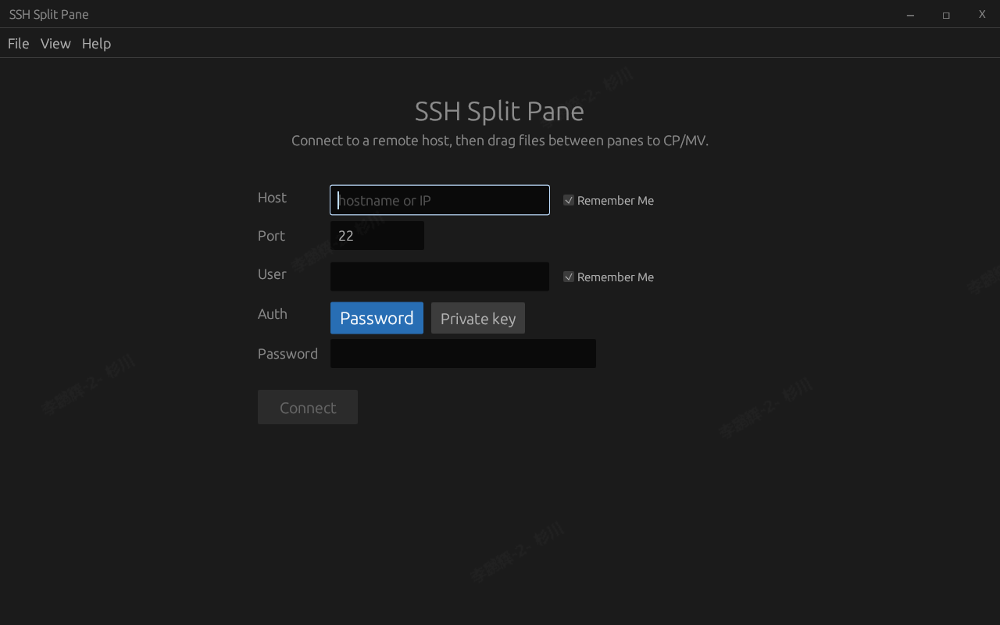
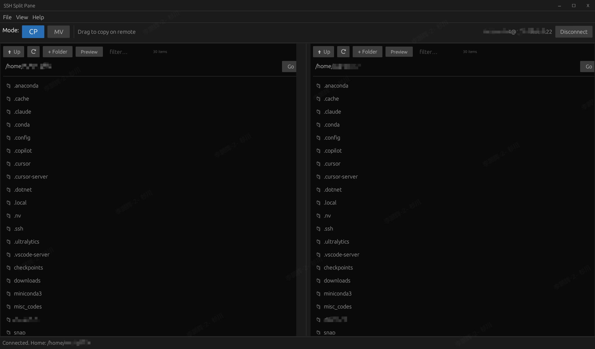

# SSH Split Pane

[English](README.md) | [中文](README-zh.md)

Windows/Linux desktop tool for **remote dual-pane** file browsing over SSH.
Drag items between panes to run remote `cp` or `mv` on the **same host** (no local file transfer — not an SFTP sync client).

**Slogan:** Same-host dual pane — drag to `cp`/`mv` over SSH.

## Download

Prebuilt binaries (when published) are on the
[GitHub Releases](../../releases) page for the latest tag (currently **v0.1.3**).

| Platform | Artifact (typical) |
|----------|--------------------|
| Linux x86_64 | `ssh_pane-v0.1.3-linux-x86_64.tar.gz` |
| Windows x86_64 | `ssh_pane-v0.1.3-windows-x86_64.zip` |

If no release assets are attached yet, build from source (below) or run:

```bash
./scripts/package-release.sh v0.1.3
```

See [RELEASE_NOTES.md](RELEASE_NOTES.md) for what changed in each version.

## Screenshots





## Features

- Connect via password by default; **Use key** on the login form for private-key auth
- **View → Theme → Dark / Light**; preference is persisted
- **File / View / Help** menu bar
- **CP / MV** mode toggle (highlighted toolbar buttons)
- Split left/right panes, each with its own remote path
- Drag from one pane to the other to copy or move on the server
- **Ctrl+click** multi-select; right-click → **Move N items to other pane**
- Per-pane **Filter** box (case-insensitive name substring)
- Per-pane **Preview** toggle (highlighted when on) for remote image preview (png/jpg/gif/webp/bmp)
- Create new folders (pane **+ Folder** or File menu)
- Overwrite confirmation when the destination name already exists
- Structured logging via `log` / `env_logger`

## Known limitations (v0.1)

- Private keys with a **passphrase** are not supported yet
- Operations are **same-host only** (remote `cp`/`mv`); no cross-host or local↔remote sync
- **Host key** is not verified against `known_hosts` (trust-on-first-use / MITM risk on untrusted networks)
- **Passwords are not persisted**; only optional remember of host / username
- No macOS build instructions in-tree yet

## Security notes

- Do not commit credentials; live SSH tests use environment variables only
- Prefer private keys over passwords when possible
- Treat early versions as convenient tools for trusted networks/hosts

Report vulnerabilities via [SECURITY.md](SECURITY.md).

## Requirements

- Rust 1.74+ (stable)
- For `ssh2` with `vendored-openssl`: a C toolchain (`build-essential` on Debian/Ubuntu; MSVC Build Tools on Windows)

### Windows (MSVC)

1. Install [Visual Studio Build Tools](https://visualstudio.microsoft.com/visual-cpp-build-tools/) with “Desktop development with C++”
2. Install [Rust](https://rustup.rs/) for `x86_64-pc-windows-msvc`
3. From this directory:

```bat
cargo build --release
```

Binary: `target\release\ssh_pane.exe`

### Linux / WSL (WSLg for GUI)

```bash
sudo apt install build-essential pkg-config libssl-dev
# Optional: faster link/cache (or use the prebuilt mold/sccache in ~/.local/bin)
#   sudo apt install mold clang sccache
# For GUI under WSL2, enable WSLg or use a Windows-built exe

# Prefer the project wrapper (pins ./target, enables mold/sccache if present)
./scripts/cargo.sh build          # debug, deps at opt-level 2
./scripts/cargo.sh build --release  # thin LTO (faster than fat LTO)
./scripts/cargo.sh build --profile dist  # fat LTO for shipping

./target/release/ssh_pane
```

**Build speed notes**

- Use `./scripts/cargo.sh …` so `CARGO_TARGET_DIR` stays at `./target` (avoids sandbox/cache redirects writing elsewhere).
- Dev profile optimizes dependencies (`opt-level = 2`) for snappier egui while your crates stay quick to recompile.
- Default `--release` uses **thin LTO**; use `--profile dist` when you want maximum size/speed optimization.
- With `mold` and `sccache` on `PATH`, the wrapper turns them on automatically (helps a lot with vendored OpenSSL).
- Longer write-up: [docs/BUILD.md](docs/BUILD.md); why release “incremental” is slow: [docs/FAQs.md](docs/FAQs.md).

Cross-compile for Windows from Linux (optional):

```bash
rustup target add x86_64-pc-windows-gnu
# needs mingw-w64
cargo build --release --target x86_64-pc-windows-gnu
```

## Usage

1. Launch the app and enter host, port, and user. Choose **Auth: Password** or **Private key** (default is password). Press **Enter** in the credential field to connect.
2. After connect, choose **CP** or **MV** in the toolbar.
3. Navigate each pane (double-click folders, **Up**, path + **Go**).
4. Drag a file or folder from one pane onto the other pane’s list.

Operations run as remote shell commands:

- Copy: `cp -a -- <src> <dst_dir>/`
- Move: `mv -- <src> <dst_dir>/`

### Logging

```bash
# default: ssh_pane=info
RUST_LOG=ssh_pane=debug ./target/release/ssh_pane
```

## Tests

```bash
# Unit tests (in-crate) + functional tests (tests/)
cargo test

# Functional suites only
cargo test --test functional_ops --test functional_pathutil --test functional_worker

# Optional live SSH functional test (ignored by default)
SSH_PANE_TEST_HOST=127.0.0.1 \
SSH_PANE_TEST_USER=me \
SSH_PANE_TEST_PASSWORD=secret \
cargo test --test functional_live_ssh -- --ignored --nocapture
```

## Project layout

```
src/
  lib.rs         # library root (pathutil / ops / ssh_worker / logging)
  main.rs        # eframe entry + logger init
  app.rs         # UI state machine
  logging.rs     # env_logger setup
  ops.rs         # pure remote command planning (testable)
  pathutil.rs    # remote paths + shell quoting
  ssh_worker.rs  # background SSH/SFTP thread
  ui/            # connect, toolbar, pane, menu widgets
tests/
  functional_ops.rs       # CP/MV/mkdir planning scenarios
  functional_pathutil.rs  # navigation / quoting scenarios
  functional_worker.rs    # worker messaging without a session
  functional_live_ssh.rs  # optional live SSH (--ignored)
```

## License

[MIT](LICENSE) © 2026 phillee
